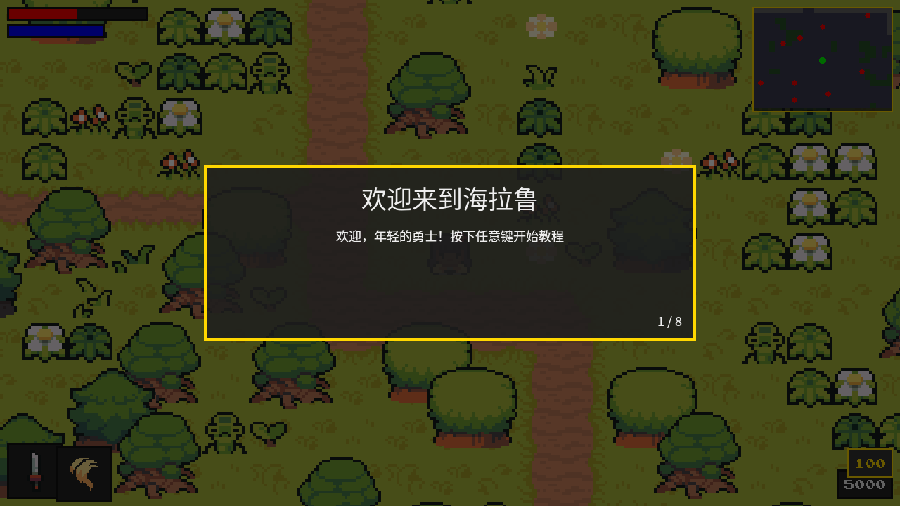
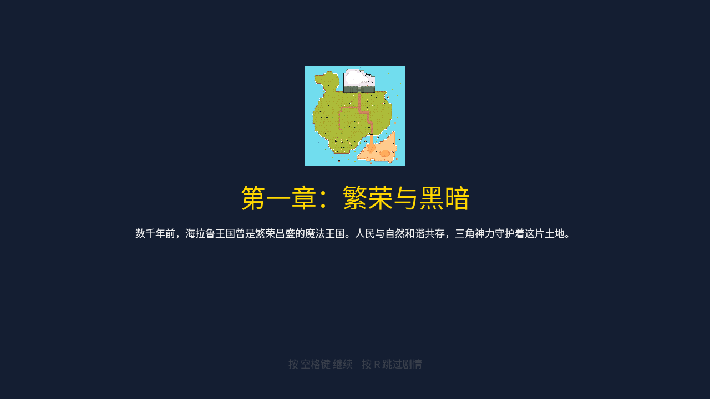

# 海拉鲁失落王国 · Lost Kingdom of Hyrule

一个用 **Python + pygame-ce** 编写的像素动作 RPG，同一份源码可以跑在桌面和浏览器里。

**在线试玩：<https://aphroditeofwsj-art.github.io/>**（WebAssembly / pygbag 打包，打开即玩，无需安装）




## 玩法内容

- **剧情演出**：22 页章节式过场，带标题、插图、淡入淡出与跳过（`R`）
- **实时战斗**：5 种武器（剑 / 斧 / 长枪 / 细剑 / 双刺）+ 火焰与治疗两种魔法
- **敌人与地图**：4 类敌人 AI、碰撞与击退、粒子特效、CSV 驱动的瓦片地图
- **成长系统**：经验升级面板、金币掉落、商店（药水 / 强化武器 / 护盾）
- **辅助 UI**：血条能量条、击杀进度、小地图、8 步新手教程
- **结局流程**：通关 / 死亡演出，可一键重开或返回标题

## 操作

| 按键 | 功能 |
| --- | --- |
| `W A S D` / 方向键 | 移动 |
| 鼠标左键 | 攻击 |
| `Q` / `E` | 切换武器 / 魔法 |
| `M` | 升级面板 |
| `G` | 商店 |
| `空格` | 推进剧情 / 确认 |
| `Esc` | 关闭面板 / 返回标题 |

## 本地运行

需要 Python 3.11+ 与 pygame-ce：

```bash
pip install pygame-ce
python code/main.py
```

## 构建 Web 版

用 [pygbag](https://github.com/pygame-web/pygbag) 把 CPython 和游戏一起编译成 WebAssembly：

```bash
pip install pygbag
# 构建目录里需要有 main.py 与 graphics / audio / map 资源
set PYTHONUTF8=1
python -m pygbag --build web
# 产物在 web/build/web/：index.html、web.tar.gz、favicon.png
```

把 `index.html`、`web.tar.gz`、`favicon.png` 放到 GitHub Pages 仓库根目录即可发布。

## 工程说明

- **跨平台资源路径**：浏览器 / Linux 的文件系统区分大小写，`graphics/Grass` 这类路径会在 Web 端静默变成空目录。资源加载统一走 `support.resolve()`，做大小写不敏感解析并对缺失资源降级，避免一帧异常拖垮整个页面。
- **浏览器端异常兜底**：`main.run()` 捕获取消帧异常后不再退出主循环，而是渲染错误提示层（`Enter` 返回标题 / `R` 重开），保证在网页里不会出现“灰屏卡死、只能刷新”的状态。
- **同一份代码双端运行**：`sys.platform == 'emscripten'` 时使用脚本所在目录作为资源根，`frozen`（PyInstaller）时使用 `sys._MEIPASS`，桌面 / 网页 / exe 三种形态共用逻辑。
- **资源与逻辑分离**：地图数据用 CSV 描述，敌人 / 武器 / 魔法数值集中在 `settings.py`，场景模块（剧情 / 关卡 / 商店 / 升级）各自独立。
