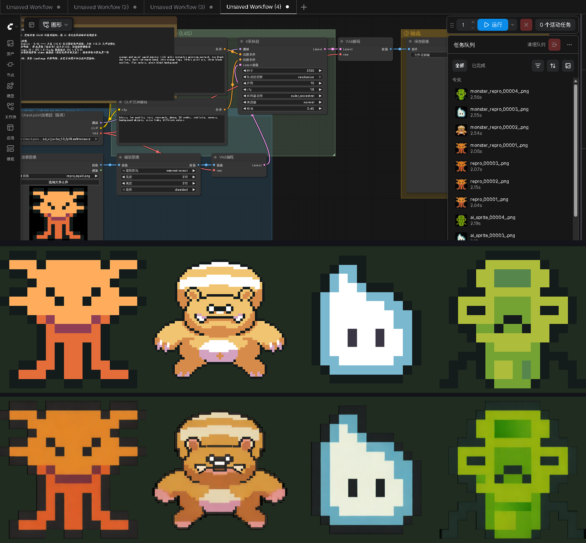

# ComfyUI 复刻游戏内怪物精灵

用本地 **ComfyUI + SDXL Turbo** 把游戏里 4 只 64×64 的像素怪物，用 img2img 重绘成同造型的高清版本。
工作流可以直接拖进 ComfyUI 打开、换参考图后复用。



> 对比图：**上排是游戏内原图，下排是 AI 复刻**（乌贼 / 浣熊 / 幽灵 / 竹妖）。

## 文件

| 文件 | 用途 |
| --- | --- |
| `monster-repro.workflow.json` | **ComfyUI 界面工作流**：拖进 ComfyUI 或 `工作流 → 打开` 即可 |
| `monster-repro.api.json` | `/prompt` 接口格式，脚本批量复刻 |
| `generate.py` | 批量复刻脚本（含抠图与等比缩回游戏尺寸） |
| `references/*.png` | 参考图：原精灵用 **最近邻** 放大到 512（放进 ComfyUI 的 `input/` 目录） |
| `samples/*.png` | 4 只怪物的复刻成品（512×512，带透明通道） |
| `monster-compare.png` | 原图 vs 复刻 对比图 |

## 环境

- ComfyUI `0.39.2`（本地部署，`--listen 127.0.0.1 --port 8188`）
- 模型：`sd_xl_turbo_1.0_fp16.safetensors`（SDXL Turbo，无 LoRA / 无 ControlNet）
- 显卡：RTX 5050 Laptop（8 GB VRAM），单张 **2–3 秒**

## 工作流结构

```
LoadImage(参考精灵) → ImageScale(nearest 512) → VAEEncode ┐
                                                          ├→ KSampler(denoise 0.45) → VAEDecode → SaveImage
CheckpointLoaderSimple → CLIP正向 / CLIP负向 ─────────────┘
```

| 节点 | 作用 | 关键参数 |
| --- | --- | --- |
| `LoadImage` | 载入参考图 | 原精灵最近邻放大后的 512×512 |
| `ImageScale` | 统一输入尺寸 | `nearest-exact`，512 × 512 |
| `VAEEncode` | 图像编码进潜空间 | 供 img2img 使用 |
| `CLIPTextEncode` ×2 | 描述该怪物的外观 / 排除项 | 见下表 |
| `KSampler` | img2img 重绘 | **denoise 0.45**，10 steps，CFG 1.8，euler_ancestral |
| `VAEDecode` → `SaveImage` | 出图落盘 | 前缀 `monster_repro` |

**denoise 为什么取 0.45**：这是复刻与重绘的平衡点。

- `> 0.6`：配色和造型会被改掉（实测乌贼从橙色变成黄色）
- `< 0.3`：几乎等于原图放大，没有重绘价值
- `0.45`：保留原配色、轮廓、五官位置，同时让边缘和阴影更自然

出图后会再用**原图的 alpha 蒙版**裁剪（这一步在 `generate.py` 里做，不占 GPU），
保证剪影与游戏内精灵完全一致，然后等比缩回 64×64（浣熊 BOSS 是 240×240）。

## 4 只怪物的提示词

统一负向词：`blurry, low quality, text, watermark, photo, 3d render, realistic, scenery, background objects, extra limbs, different colors`

| 怪物 | seed | 提示词 | 产出 |
| --- | --- | --- | --- |
| 乌贼 squid | 5150 | orange and coral squid monster with spiky tentacles pointing outward, two black dot eyes, dark red mouth band, thin orange legs, 16-bit pixel art, thick black outline, flat colors, plain black background | `samples/squid.png` |
| 浣熊 raccoon | 5151 | tan and brown raccoon beast, cream fur on top of head, angry face with fangs, dark red eyes, pink belly, big paws with claws, 16-bit pixel art, … | `samples/raccoon.png` |
| 幽灵 spirit | 5152 | pale blue and white ghost blob monster, light blue outline, two black oval eyes, rounded body, 16-bit pixel art, … | `samples/spirit.png` |
| 竹妖 bamboo | 5153 | green bamboo plant monster, lighter green face area, dark green outline, tendril legs, 16-bit pixel art, … | `samples/bamboo.png` |

## 怎么用

1. 把 `references/*.png` 拷进 ComfyUI 的 `input/` 目录
2. 在 ComfyUI 里打开 `monster-repro.workflow.json`
3. 改 `LoadImage` 的参考图 + `CLIPTextEncode` 的提示词，点「运行」

或者用脚本批量跑（服务需在 8188 端口）：

```bash
python docs/comfy/generate.py
```

## 经验

- **参考图必须用最近邻放大**：双线性放大会把像素边缘糊成灰边，模型会跟着画出模糊轮廓
- **CFG 别开高**：Turbo 模型 1.0–2.0 即可，> 3 会过曝、色块崩坏
- **同一种子可复现**：同一参考图 + 同一提示词 + 同一种子，结果稳定，方便成套出图
- **透明通道不要交给模型**：让模型画纯黑背景，出图后按原图 alpha 裁剪，比让 AI 画透明底可靠得多
